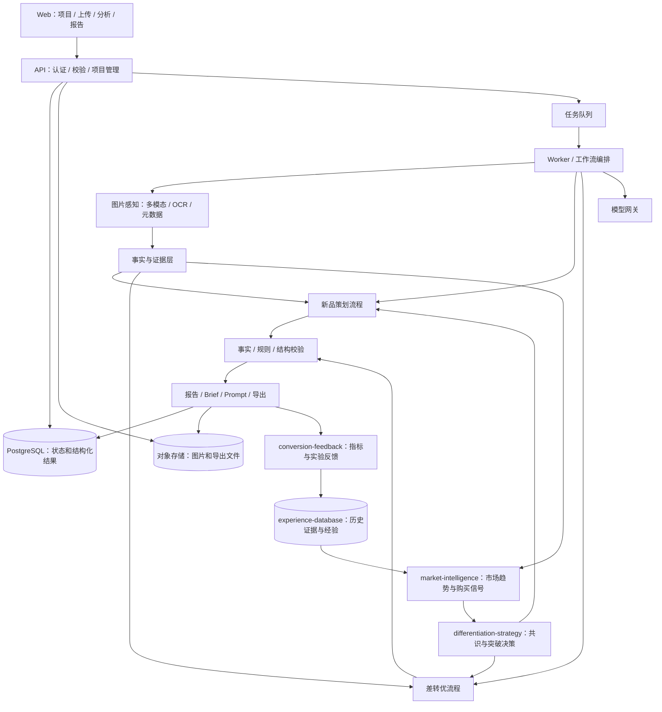

# Amazon Listing Visual Optimization Agent：项目架构

状态：设计提案，尚未实现。本文定义产品、技术和交付边界，作为后续开发基线。

## 1. 产品目标与边界

为 Amazon Listing 提供可执行、可追溯的视觉策划和改图方案，支持两条工作流：

1. **新品视觉规划**：产品分析 → 用户画像假设 → 场景策划 → 图片结构 → AI Prompt。
2. **老 Listing 差转优**：当前图片诊断 → 优秀竞品对比 → 差距归纳 → 优化方向 → 修改优先级 → AI 修改 Prompt。

主要用户是运营、设计师和品牌负责人。系统输出设计决策与制作任务；初期不自动发布 Listing，不自动抓取 Amazon，不承诺提高转化率。图片生成作为后续可选功能，不能阻塞核心方案交付。

默认分析单位是一个产品、一个站点、一种输出语言和一个图片组。项目可以建立多个版本，用于比较新方案和实际结果。

## 2. 输入和输出契约

### 2.1 公共输入

| 输入 | 内容 | 处理原则 |
| --- | --- | --- |
| 产品事实 | 品类、规格、材质、尺寸、包装清单、功能、限制、证明材料 | 区分已确认事实、用户陈述和待确认信息 |
| 市场上下文 | 站点、输出语言、价位、目标客群、品牌定位 | 不足时显式记录假设 |
| 图片资产 | 产品原图、现有图片、竞品图片；角色和顺序 | 保存原图，衍生缩略图用于分析 |
| 创意约束 | 风格、品牌色、禁用表达、交付尺寸 | 进入策划和 Prompt 校验 |
| 可选业务证据 | 时间区间、流量、CVR、广告来源、评价、退货原因 | 保存来源和统计口径；不混同图片推断 |

图片输入支持上传，初期不直接访问用户提供的任意 URL。用户标注主图、辅图、A+，并确认竞品的用途和来源。“TOP”仅代表用户选定的优秀参考，除非另有排名或经营数据证据。

### 2.2 新品输出

- 产品事实摘要、购买障碍、卖点及其证据。
- 用户画像：购买动机、使用任务、顾虑、触发场景，标记推断和置信度。
- 场景库：场景目的、人物、地点、产品动作、需要证明的价值。
- 图片结构：主图、卖点图、场景图、规格图、对比图等按需要组合，数量可配置。
- 每张图片的制作 Brief：目标、核心信息、构图、素材需求、文案、验收标准。
- 每张图片的 AI Prompt：生成指令、产品保真约束、避免项、文字图层计划。

### 2.3 差转优输出

- 当前图片逐张诊断和整个图片组的叙事诊断。
- 竞品图片中可观察的有效表达及可借鉴原则。
- 与优秀参考的差距矩阵，覆盖缺失信息、信息顺序、表达清晰度和场景匹配。
- 优化方向、修改清单与优先级，每项关联原图、证据、理由、成本和不确定性。
- AI 修改 Prompt，明确保留区域、修改区域、是否需要蒙版、所需参考素材。
- 验证计划：哪些是视觉质量验收，哪些需要真实流量实验。

交付格式为结构化 JSON 和可阅读的 Markdown 报告；前端展示同一份结构化结果，避免两套结论不一致。

## 3. 总体架构

采用**模块化单体 + 独立任务 Worker**，先保持单一业务代码库和统一数据模型。这里的 Agent 是受约束的工作流执行器；产品分析、诊断、策划等是逻辑步骤，不要求部署独立智能体。



### 推荐技术栈

| 层 | 选择 | 原因 |
| --- | --- | --- |
| Web | Next.js + TypeScript | 图片对照、结构化表单和报告交互 |
| API / Worker | Python + FastAPI + Pydantic | 多模态处理、数据校验和工作流实现 |
| 数据库 | PostgreSQL | 项目版本、证据关联、任务状态和审计 |
| 异步任务 | Redis + Celery | 长任务、重试、进度；数据库保存业务状态 |
| 图片存储 | S3 兼容存储，本地使用 MinIO | 原图、衍生图和导出文件分离 |
| 本地运行 | Docker Compose | Web、API、Worker、数据库和存储统一启动 |
| 模型 | 可替换的多模态模型适配器 | 不将业务流程绑定单一厂商 |

MVP 无需向量数据库、复杂自主规划框架或微服务。规则和模板先按版本保存在仓库；达到检索规模后再增加知识库。

## 4. 核心模块与职责

| 模块 | 职责 | 主要产物 |
| --- | --- | --- |
| Project / Intake | 项目、输入完整性、工作流选择和版本管理 | 冻结的输入快照 |
| Asset Service | 上传校验、元数据、缩略图、哈希去重、角色排序 | ImageAsset |
| Visual Perception | 图中产品、场景、文字、构图、信息层级和可读性 | ImageObservation |
| Evidence Registry | 区分观察、产品事实、业务数据和模型推断 | Evidence / Finding |
| Product Analyst | 提炼有证据的价值和购买障碍 | ProductProfile |
| Audience / Scene Planner | 建立用户假设与使用场景 | Persona / Scene |
| Listing Planner | 组织图片顺序、信息覆盖和逐图 Brief | ImagePlan |
| Diagnostic Engine | 单图问题与组图信息覆盖诊断 | Diagnosis |
| Benchmark Comparator | 按图片功能对齐竞品，归纳差距 | GapMatrix |
| Optimization Planner | 生成可执行改动和优先级 | ChangeTask |
| Prompt Compiler | 从 Brief / ChangeTask 编译模型适配 Prompt | PromptPackage |
| Validation Engine | 校验事实、规格一致性、规则和输出完整性 | ValidationResult |
| Report / Export | 展示证据、方案、任务和导出 | ReportVersion |
| Evaluation / Feedback | 专家评价、回归样本和真实实验结果 | EvaluationRecord |
| market-intelligence | 分析同细分市场竞品趋势、常见视觉模式和购买信号 | MarketSnapshot / VisualPattern / PurchaseSignal |
| differentiation-strategy | 判断市场共识、突破空间及主流或差异化路线 | StrategyDecision / DifferentiationPlan |
| conversion-feedback | 接收 CTR、CVR、广告表现与 A/B 测试，校验口径并关联方案版本 | MetricObservation / ExperimentResult |
| experience-database | 保存历史方案、结果、适用条件与经验，供后续检索 | ExperienceRecord / ExperienceRetrieval |

各业务模块输入输出均使用版本化 Schema。模型原始文本必须通过结构校验，不能直接成为正式报告。

## 5. 工作流设计

### 5.1 新品视觉规划

```text
输入校验与快照
  → 产品事实和素材提取
  → 卖点 / 顾虑 / 用户画像假设
  → 场景候选与筛选
  → 图片组结构与信息覆盖
  → 每图 Brief
  → Prompt 编译
  → 事实与规则校验
  → 报告与制作任务
```

关键要求：每张图解决一个主要购买问题；每个功能性卖点必须关联事实来源；尺寸、包装、认证等关键缺失信息不得被补造。缺失核心信息时生成待补清单，其余部分可以形成明确标记的草案。

图片数量和类型根据品类及输入约束配置。系统可以给出推荐顺序，但不能假定所有品类都适合固定七图模板。

### 5.2 差转优项目

```text
现有图 / 竞品图上传与角色确认
  → 独立分析各图
  → 当前图片组诊断
  → 按图片功能对齐竞品
  → 差距矩阵与可借鉴原则
  → 优化任务、依赖与优先级
  → 编辑 Prompt / 重做 Brief
  → 产品保真与规则校验
  → 报告与实验建议
```

竞品缺少对应图片时记录“未提供参考”，不强行一一匹配。比较以表达方式和信息覆盖为主，不能把竞品的产品性能当成本品卖点。存在多个参考时报告共同模式和不同策略，而不是简单平均。

优先级分为 P0 必须处理、P1 优先验证、P2 后续改进：

- P0：产品事实错误、误导性表达或有明确来源的规则冲突。
- P1：关键购买信息缺失、主图识别困难、移动端文字明显难读等。
- P2：风格统一、细节装饰和尚缺证据的创意试验。

同级内部参考预期影响、证据强度、制作成本和依赖排序。输出排序理由，不输出未经验证的“预计提升 CVR 百分比”。数据缺失时只能判断视觉问题，不能确认低转化由图片造成。

### 5.3 执行与恢复

任务状态：`queued → running → succeeded / needs_input / failed / cancelled`。每一步保存输入哈希、模型版本、模板版本、输出和检查结果。

- 长步骤支持超时、有限重试和取消；已完成步骤可以复用。
- 用户补充信息或改输入会产生新版本，不覆盖历史结果。
- 采用输入快照哈希与工作流版本作为幂等依据，防止重复点击重复计费。
- 对限流和网络错误退避重试；结构错误有限修复后报告失败。
- 队列消息允许重复投递，通过数据库状态和步骤键避免重复提交结果。
- 用持久化 Outbox 或等效机制解决数据库提交成功但入队失败的问题。

## 6. 数据模型和证据链

```text
Project
 ├── ProductVersion
 ├── AssetSetVersion → ImageAsset
 └── AnalysisRun
      ├── StepRun
      ├── Evidence → Finding
      ├── Persona / Scene
      ├── ImagePlan / Diagnosis / Gap
      ├── ChangeTask → PromptPackage
      ├── ValidationResult
      └── ReportVersion → EvaluationRecord
```

核心字段：

| 实体 | 必要字段 |
| --- | --- |
| Project | id、owner_id、mode、marketplace、locale、status |
| ProductVersion | facts、claims、constraints、missing_fields、source_refs |
| ImageAsset | id、storage_key、sha256、mime、width、height、role、position、source_type |
| AnalysisRun | id、input_snapshot、schema_version、workflow_version、status、usage、cost |
| Evidence | id、source_type、asset_id / source_ref、区域坐标或文本摘录、可靠性 |
| Finding | id、statement、kind、evidence_ids、confidence、limitations |
| ImagePlan | role、objective、message、scene、composition、copy、acceptance_criteria |
| Gap | dimension、current_finding_ids、reference_finding_ids、recommendation |
| ChangeTask | asset_id、action、priority、rationale、dependencies、effort、acceptance_criteria |
| PromptPackage | mode、prompt、constraints、reference_asset_ids、mask_requirement、text_layers |

`Finding.kind` 必须区分 `observed`、`user_provided`、`inferred`。置信度只是模型或规则的不确定性描述，不能当作统计显著性。

示例：

```json
{
  "id": "finding_001",
  "statement": "当前规格图未清晰展示产品尺寸",
  "kind": "observed",
  "evidence_ids": ["evidence_current_image_03"],
  "confidence": "medium",
  "limitations": ["仅分析用户提供的图片，未检查完整详情页"]
}
```

## 7. Prompt 系统

Prompt 采用分层模板：业务任务 → 产品事实 → 视觉 Brief → 素材引用 → 产品保真约束 → 站点规则 → 输出 Schema。模板保存在 `prompts/` 并记录版本。

分别提供 `generation` 和 `editing` 模式：

- 生成：主体、场景、构图、光线、镜头、留白和目标信息。
- 编辑：指定源图、保留内容、修改内容、参考图用途和蒙版要求；不能只给模糊的“更高级”。
- 保真：产品形状、颜色、Logo、接口、配件数量和尺寸关系必须保持一致。
- 文字：文案和版式单独输出，建议后期叠加；图片模型的文字生成不能保证准确。

竞品作为表达参考，不要求复制商标、包装或原图构图。Prompt 编译器通过适配器转换厂商参数；负向提示和蒙版等能力按实际模型支持声明，不能默认为通用能力。

## 8. 诊断维度与规则管理

公共维度包括产品识别、卖点清晰度、信息覆盖、场景相关性、顾虑处理、移动端可读性、图片组一致性、产品真实性和规则风险。

主图、辅图与 A+ 使用不同评分量表。评分用于解释诊断和同版本比较，不是预测转化的模型；无证据的维度标记“无法判断”。报告以证据与建议为主，避免总分掩盖关键问题。

规则采用 `marketplace + category + image_role + effective_date` 定位，记录官方来源 URL、检查日期和适用范围。没有有效规则来源时给出待核实提示。主图背景、文字、配件展示等条件按具体站点和品类核实，不能将经验规则视为永久通用规则。

## 9. API 与前端信息架构

主要 API：

```text
POST   /v1/projects
GET    /v1/projects/{id}
PUT    /v1/projects/{id}/product
POST   /v1/projects/{id}/assets/uploads
POST   /v1/projects/{id}/assets/uploads/{upload_id}/complete
PATCH  /v1/projects/{id}/assets/{asset_id}
POST   /v1/projects/{id}/runs
GET    /v1/projects/{id}/runs/{run_id}
POST   /v1/projects/{id}/runs/{run_id}/cancel
GET    /v1/projects/{id}/reports/{report_id}
POST   /v1/projects/{id}/reports/{report_id}/exports
POST   /v1/projects/{id}/reports/{report_id}/feedback
```

前端页面：项目列表 → 创建项目与模式选择 → 产品信息 → 素材上传与排序 → 输入检查 → 分析进度 → 结果工作台。

新品结果展示图片顺序和逐图 Brief；差转优结果展示现有图与竞品对照、问题定位和修改队列。两种模式都支持查看证据、确认假设、复制 Prompt、导出和建立修订版本。

MVP 使用轮询获取任务进度，后续需要时再增加 SSE。所有对象访问校验项目归属；上传完成后由服务端验证实际文件，不能只信任浏览器上报。

## 10. 安全、成本和可观测性

- 图片和 OCR 文字均视为待分析数据，不能成为执行指令。模型不得因此读取秘密、执行命令或访问任意地址。
- 校验文件类型、大小、像素上限和解码结果；移除无用 EXIF，防止异常文件和解压资源消耗。
- 默认项目私有，签名链接短时有效；身份认证和项目授权在开放多用户前必须实现。
- API 密钥保存在服务端安全配置中，不写入仓库、Prompt 或前端。
- 记录 run_id、步骤耗时、模型用量、费用和失败类别；日志避免原始敏感内容。
- 设置单项目图片数、单任务预算和模型调用上限；缓存只在相同输入、模板和模型版本下复用。
- 原图不覆盖；明确删除和保留策略，导出资产同样受授权控制。
- 图片生成如启用，应按用户明确触发计费，与文本分析预算分别控制。

## 11. 验证与质量标准

| 层级 | 验证内容 |
| --- | --- |
| 单元测试 | Schema、优先级规则、输入校验、Prompt 编译和版本逻辑 |
| 集成测试 | 上传 → 入队 → 执行 → 持久化 → 导出；鉴权和失败恢复 |
| 模型契约测试 | 固定样本下真实模型能否返回合法结果，包含用量与错误处理 |
| 领域评估 | 运营与设计师评审问题准确性、证据关联、事实保真和建议可执行性 |
| 回归集 | 新品与差转优各覆盖多个品类；含缺失信息、差图和错误产品声明 |
| 业务实验 | 记录对照方案、流量分配、时段和其他变量，评估实际转化变化 |

离线评估不能证明 CVR 改善。模型输出允许合理差异，以事实一致性、证据、信息覆盖和制作可执行性评估，不用整段文本相等作为主要断言。

核心验收要求：每个正式问题结论能追溯证据；每项修改有理由和验收标准；无依据的卖点不进入最终文案；关键事实缺失时不能输出“可直接发布”。结构测试可使用模拟模型，但发布就绪还需要真实模型端到端验证。

## 12. 建议目录结构

以下是后续实现结构，不代表文件已创建：

```text
amazon-visual-skill/
├── README.md
├── docs/
│   ├── architecture.md
│   ├── data-contracts.md
│   └── evaluation.md
├── apps/web/                    # Next.js UI
├── backend/
│   ├── pyproject.toml
│   ├── src/amazon_visual/
│   │   ├── api/
│   │   ├── domain/               # 产品、资产、证据、结果模型
│   │   ├── workflows/            # new_listing / optimization
│   │   ├── services/             # 感知、策划、诊断、编译、校验
│   │   ├── adapters/             # 模型、存储、队列
│   │   ├── persistence/
│   │   └── workers/
│   ├── migrations/
│   └── tests/
├── prompts/
│   ├── perception/
│   ├── new_listing/
│   ├── optimization/
│   └── validation/
├── rules/                       # 带来源与版本的站点/品类规则
├── evaluations/                 # 经授权的测试资产和评分量表
├── skills/amazon-listing-visual/ # 可选 Agent 入口，复用业务服务
└── infra/                       # Compose 与配置示例，不含秘密
```

Skill 作为同一业务能力的入口，调用服务或工作流，不复制另一份领域逻辑。先开发核心服务，再接入 Web 和 Skill。

## 13. 分阶段交付

### 阶段一：领域核心与报告 MVP

完成数据契约、模型网关、上传与图片观察、两条工作流、事实校验、JSON / Markdown 输出。先通过 CLI 执行，支持真实模型验证。

验收：一组新品素材和一组现有图 / 竞品图能分别生成完整交付物；关键缺失输入、模型失败和无证据结论有明确处理。

### 阶段二：可协作的 Web MVP

完成项目管理、认证授权、对象存储、任务 Worker、证据对照界面、改图任务、版本和导出。保存完整安装及服务启动配置。

验收：浏览器中完成两条端到端流程；任务可恢复、预算受控、项目之间不能越权访问。

### 阶段三：评估与优化闭环

增加专家反馈、领域回归集、可配置品类模板，以及用户输入的实验结果对照。版本升级必须通过约定的质量门槛。

### 阶段四：可选扩展

接入图片生成 / 编辑、蒙版工具、A+ 专用规划和批量项目。Amazon 数据接口、自动抓取和发布属于独立扩展，需要单独明确授权、接口和验收标准。

## 14. 已确定的设计原则与后续决策

已确定：两条流程共享证据和模型底座；优先模块化单体；报告与制作任务为首要产物；现有图片始终保留；转化结论必须以业务证据验证。

实现前需确定首个目标站点 / 品类、模型供应商及预算、部署方式与身份认证方案。这些选择不影响当前架构设计；可先实现供应商无关的数据契约和核心工作流。

## 15. 核心能力增强：市场洞察与合理差异化策略

新增能力解释“为什么不好”，并判断应恢复市场熟悉的表达，还是在保持识别与信任的基础上建立记忆点。市场常见不等于有效，高销量也不能单独证明其视觉设计带来了销量。

### 15.1 四个模块的输入输出与边界

| 模块标识 | 输入 | 输出 | 边界 |
| --- | --- | --- | --- |
| `market-intelligence` | 竞品图、品类 / 关键词、价位、人群、图片角色、采集日期、排名 / 销量依据、历史经验 | 市场快照、视觉模式分布、熟悉购买信号、证据与局限 | 不从图片推断销量，不将小样本称为整个市场 |
| `differentiation-strategy` | 产品事实、当前诊断、市场快照、品牌约束、历史证据 | 必须保持项、可突破项、路线选择、假设和验收标准 | 真实与合规优先，不为创新牺牲识别与可读性 |
| `conversion-feedback` | 报表 / 人工录入、方案版本、实验分组、曝光 / 点击 / 访问 / 订单、广告数据 | 口径校验结果、指标、效果对照、不确定性和混杂因素 | 无可比数据时不作因果归因，不自动发起或发布实验 |
| `experience-database` | 项目输入快照、决策、前后图、反馈、人工复核、适用条件 | 可追溯经验、相似案例和检索理由 | 不把所有成功案例变成通用规则；保留失败与无结论结果 |

模块作为现有单体内的领域服务实现，不新增独立微服务。`conversion-feedback` 负责业务指标；既有 Evaluation / Feedback 继续负责专家评价与模型质量。`experience-database` 复用 PostgreSQL 和对象存储，后续必要时增加向量检索。

### 15.2 市场样本与主流审美判断

补充输入 `MarketSample`：竞品身份、站点、细分品类、关键词、人群、价格带、图片角色、采集时间、来源、TOP / 销量证据及样本选择原因。初期由用户提供图片和合法导出的数据，不改变现有的非自动抓取边界。

处理步骤：

1. 检查样本可比性，按品类、人群、价格带、图片角色和时期分层。
2. 独立提取产品角度、占比、布局、色调、光影、场景、人物、文字和信息顺序。
3. 同一 Listing / 变体去重，以 Listing 为统计单位，避免图片数量多的竞品主导结论。
4. 报告各模式的出现次数、有效样本数和缺失观察；只在存在时间序列时判断趋势变化。
5. 归纳可能帮助用户识别品类、理解用途和建立信任的购买信号，并记录依据与例外。

“高销量款式常见模式”仅分析有销量依据的子集；排名、销量、销售额必须区分，不能互相替代。未验证 TOP 的样本称为“用户选定参考”。单张优秀图可以支持参考建议，不能建立市场共识；代表性不足时输出局部观察与待验证假设。

每个模式记录 `observed_common_pattern`、`inferred_purchase_signal` 或 `validated_effect`，分别对应常见现象、解释假设和特定条件下的效果证据。常见现象不得自动升级为已验证效果或平台规则。

### 15.3 合理差异化与 80/20 原则

遵循 **80% 符合市场主流审美，20% 形成差异化优势**。这是策略启发式：让主要识别和购买信息沿用熟悉表达，在少量有理由的维度建立记忆点；不指画面面积、像素数、图片数量或可计算的转化贡献。

| 元素类型 | 策略 | 示例与限制 |
| --- | --- | --- |
| 硬约束 | 必须保持，与比例无关 | 产品事实、平台要求、真实尺度、清晰度与可读性 |
| 市场共识 | 有证据时优先保持 | 熟悉的产品视角、关键结构展示、必要规格和用途说明；不是永久不可改变 |
| 差异化空间 | 在不破坏识别的前提下试验 | 更清晰的独特结构呈现、针对性场景、辅图的信息层级或品牌表达 |

主图差异化限于合规的真实产品展示，不用装饰或背景突破官方约束。产品颜色、结构和材质只能如实呈现；策略不得改变它们来制造记忆点。

每项 `StrategyDecision` 必须回答：现有问题为何影响识别或理解；市场依据是什么；保留什么；突破什么；为何适合本产品与用户；预期机制是什么；如何验证。

路线选择：

- **主流修复 `mainstream_repair`**：缺少重要购买信号或识别基础时，先补齐共识表达。
- **受控差异化 `controlled_differentiation`**：基础已满足且有真实优势时，选择少量低风险突破点。
- **先修复后差异化 `repair_then_differentiate`**：同时存在基础问题和表达机会时，先修复再试验。
- **证据不足 `insufficient_evidence`**：样本或产品依据不足时只给条件方案，不强行选择路线。

没有明显突破空间时允许保持稳健主流方案，不为满足“20%”添加噱头。保留差异化假设，不将其描述为已获得竞争优势。

### 15.4 两条工作流的接入

本节为第 5 节流程的增强步骤，原有诊断、策划和校验全部保留。

- 新品：产品事实 / 用户假设 → 市场样本分析 → 购买信号与策略决策 → 场景 / 图片结构 / Brief → Prompt / 校验 / 报告。
- 差转优：独立观察 / 当前诊断 / 竞品对齐 → 市场模式与原因解释 → 主流修复或差异化决策 → 修改优先级 / 方案 / Prompt → 校验 / 报告。
- 闭环：用户确认方案版本 → 实际交付图版本 → 导入表现与实验结果 → 数据质量检查 → 效果解释与人工复核 → 经验入库 → 后续项目检索。

没有市场资料时保留原有工作流，同时将市场洞察标记缺失；不能伪造市场分析。真实流量反馈是未来扩展，不是基础分析报告交付的前置条件。

### 15.5 数据模型增强

| 实体 | 新增关键字段 |
| --- | --- |
| MarketSnapshot | id、segment、keyword、price_band、audience、observed_at、sample_ids、selection_method、limitations |
| MarketSample | competitor_ref、asset_ids、image_role、source、sales / rank_evidence_refs、captured_at、dedup_key |
| VisualPattern / PurchaseSignal | id、description、kind、sample_count、eligible_count、evidence_ids、confidence、applicability |
| StrategyDecision | id、route、problem_finding_ids、market_snapshot_id、preserve_elements、breakthrough_elements、rationale、hypothesis、validation_plan |
| MetricObservation | id、asset_set_version_id、source、window、timezone、traffic_segment、counts、metric_definition、attribution_window、quality_flags |
| ExperimentResult | id、control_version、variant_version、allocation_method、primary_metric、guardrails、sample_sizes、effect、uncertainty、confounders、outcome |
| ExperienceRecord | id、project_id、strategy_id、before / after_versions、feedback_ids、context、finding、evidence_level、review_status、valid_until、visibility |
| ExperienceRetrieval | id、run_id、record_ids、match_reasons、context_differences、excluded_reasons |

`AnalysisRun` 关联市场快照、策略决策和经验检索快照；`ImagePlan`、`ChangeTask` 和 `PromptPackage` 关联策略 ID，使保留项和突破项贯穿实际制作。记录更新创建新版本，不覆盖原始证据。

### 15.6 反馈口径、实验与经验数据库

- CTR 保存原始曝光与点击，按同口径计算 `clicks / impressions`。
- CVR 必须标明分母为点击、会话还是其他指标；保存分子定义，不混算订单数、售出件数和买家数。
- 广告表现保存广告类型、投放位置、受众、关键词、花费、归因销售额、时间及归因窗口；ACOS 和 ROAS 仅在口径明确时计算。
- 分母为零、归因未成熟、缺失数据或窗口重叠时标记不可计算或不完整；汇总率按原始计数计算，不简单平均百分比。
- A/B 记录对照 / 变体、随机化或分流方式、主指标、护栏、实验时长、样本量及不确定性。未随机的前后对比归类为观察结果。
- 区分 `improved`、`degraded`、`no_clear_difference` 和 `invalid`；无结论不等于无效果，也不算成功。
- 检查价格、促销、库存、评价、流量结构和同时修改的文案等混杂因素；CTR 提升但 CVR 下滑时报告权衡，不能自动判胜。
- 整组图片一起改变时，只能评价组合方案，不能归功于单个设计元素。对每项实验预先定义判定规则，避免看到结果后修改目标。

经验库存储观察、实验和专家判断，分别标记证据等级与适用条件，保留成功、失败和无结论案例。检索优先匹配站点、品类、人群、价格带、图片角色、流量及时期，展示相似理由和差异；过期或相互矛盾的经验降低权重并提示重新验证。单个项目结果不能直接晋升通用规则。

项目经验默认仅归属用户可见；跨项目或跨用户共享必须有授权并去标识。删除和保留策略覆盖历史图、经营数据及衍生经验。

### 15.7 输出、API 与目录增强

两类报告均增加：市场样本说明、视觉趋势表、熟悉购买信号、问题原因链、市场共识 / 可突破元素矩阵、路线选择和验证计划。原因链为“图片观察 → 市场依据 → 用户理解机制假设 → 决策”，缺失证据明确标记。

结构化结果新增 `market_insights`、`strategy_decisions`、`feedback_summary`、`experience_refs`，缺失时用明确状态而非虚构内容。Prompt 增加来自策略的必须保留项和允许突破项；不能冲突于产品事实或平台要求。

建议增加 API（尚未实现）：

```text
POST /v1/projects/{id}/market-snapshots
GET  /v1/projects/{id}/market-snapshots/{snapshot_id}
POST /v1/projects/{id}/metric-imports
POST /v1/projects/{id}/experiments
GET  /v1/projects/{id}/experiments/{experiment_id}
POST /v1/projects/{id}/experiments/{experiment_id}/results
POST /v1/experiences/search
```

所有 API 校验归属与来源；导入幂等，反馈关联实际图片版本而非仅关联报告。前端增加市场洞察 / 策略面板和未来的反馈 / 历史经验视图。

目录模块的业务标识保持为 `market-intelligence`、`differentiation-strategy`、`conversion-feedback`、`experience-database`；Python 文件使用合法的下划线名称：

```text
backend/src/amazon_visual/services/
├── market_intelligence/
├── differentiation_strategy/
├── conversion_feedback/
└── experience_database/
prompts/
├── market_intelligence/
└── differentiation_strategy/
evaluations/
├── market_patterns/
└── feedback_cases/
```

### 15.8 交付与验收增强

- 阶段一增加市场样本输入、主流模式归纳、购买信号及 80/20 策略报告；先使用人工提供的参考与数据。
- 阶段二增加市场快照、策略版本与经验引用展示，保留后续反馈的数据契约。
- 阶段三实现 `conversion-feedback` 与 `experience-database` 的导入、计算、检索和人工复核；外部平台接口作为独立后续扩展。
- 验收覆盖：单参考不能推出市场共识；排名不能代替销量；过期 / 不可比数据不能直接引用；80/20 不能突破事实和平台约束；零分母及混杂实验不能得出确定改善；失败经验不会被隐藏；跨项目经验不能越权。
- 回归评审增加“原因解释有据”“路线选择合理”“保留项和突破项明确”“经验适用条件正确”；真实实验才可形成特定条件下的效果结论。

以上为架构与规则增强，不代表四个模块已实现或反馈数据已接入。

## 16. Visual Benchmark Library v0.1

在现有项目内增加[视觉图片知识库](../case-library/visual-benchmark-library/README.md)，不另建服务或独立应用。文件式数据库作为未来 experience-database 的图片参考来源，保留原 Benchmark 产品 / 场景匹配、Creative Reference Group 方法学习和 Creative Composition 构图策略。

数据流：实际图片及老师评分来源 → 原文件与 SHA-256 → 每图 metadata.json → 人工观察与授权复核 → database.json 登记 → 事实 / 用途过滤与可解释标签排序 → Agent 实际查看候选 → 视觉规则与独立设计 → 成图六维评价。老师原分、新量表与经营指标独立记录。

实现边界：v0.1 提供 JSON Schema、空数据库、元数据模板、分类目录、只读校验 / 检索 / 评分计算 CLI 和回归测试。未提供首批评分原图时不生成实际记录。尚未实现上传服务、图像自动打标、向量嵌入或检索、训练、生成、发布与经营反馈接入；后续适配器保持 image_id 和证据契约。

新单图量表 visual-benchmark-v0.1 使用30/20/15/15/10/10权重，旧 marquee-visual-v1 保留。所有总分仍受真实 SKU、比例、材质、灯色及适用官方要求的硬门槛约束；不以高分抵消事实错误。heart-light 仅新增经资料确认的 KT 板心形形态，其余灯具不在范围内。

### 16.1 增量图片导入

新增 scripts/benchmark_importer.py：扫描集中 images/，哈希去重、CR ID 持久化、pending 元数据与数据库摘要同步；支持前台监听、原子写入、并发锁及提交中断恢复。新增原图不重命名，已登记原图内容改变不静默覆盖旧身份。正式检索仍只使用已复核 active 记录。

本地模式只计算像素特征与文件名候选；可选 OpenAI 视觉接口生成语义分析，需显式开启和用户环境配置，当前仅适配逻辑及模拟测试验证，未执行真实远程调用。模型不能授予老师评分、产品事实或发布资格；已有人工分析保护不覆盖。向量检索、模型训练、后台服务部署及图片发布仍未实现。
